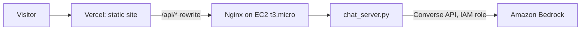

# Sunday Daniel Friday: Portfolio

Personal portfolio for AI Evaluation & Engineering. Live at **https://sundayfriday.vercel.app**

The site is plain HTML/CSS/JS with no build step. Its "Ask my AI" assistant answers visitors' questions about my experience and projects through a small Python backend that calls **Amazon Bedrock** from an **AWS EC2** instance.

## Architecture



- **Frontend** (`site/`): dark, responsive single page with scroll reveals, project filters and an accessible chat widget. It respects `prefers-reduced-motion`.
- **Backend** (`server/`): uses only the Python standard library plus `boto3`. It answers only from `profile.md` and enforces per-visitor and daily rate limits so it can't run up costs.
- **Infra** (`deploy/`): `deploy.ps1` sets up everything with the AWS CLI and is safe to re-run. It creates:
  - A private S3 bundle bucket
  - An IAM role with least privilege (Bedrock invoke and S3 read)
  - A security group with HTTP/HTTPS only (no SSH; the server is managed through SSM)
  - An Amazon Linux 2023 instance with IMDSv2 and an encrypted gp3 volume
  - An Elastic IP
  - A monthly AWS Budget alert

  Re-running it pushes new code through SSM Run Command.

## Run locally

```bash
pip install boto3
python server/chat_server.py --static site --port 8080
```

Then open http://localhost:8080. The chat needs AWS credentials with Bedrock access, and shows a friendly fallback without them.

## Deploy

```bash
vercel deploy --prod --yes --cwd site                  # frontend
powershell -ExecutionPolicy Bypass -File deploy\deploy.ps1   # EC2 backend
```
